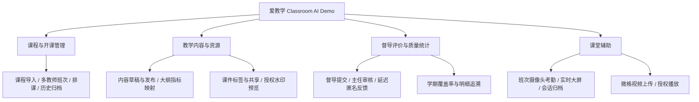
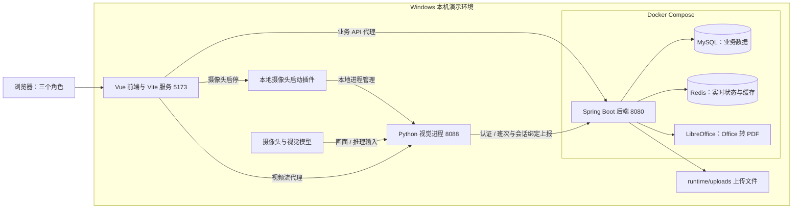
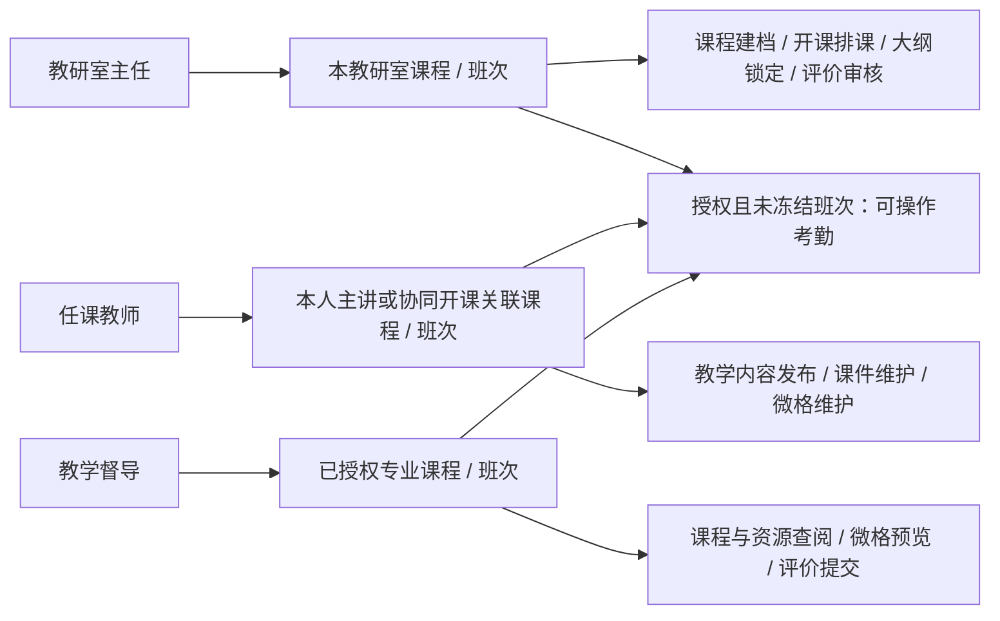
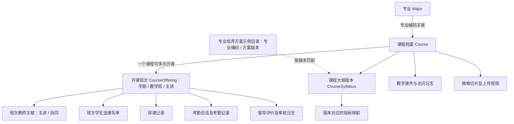
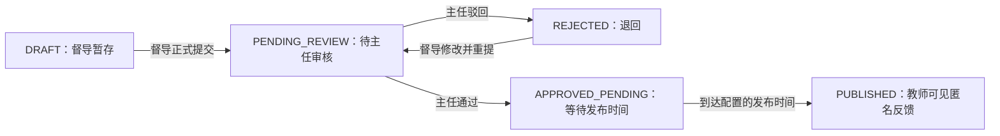

# 爱教学：开发维护交接说明与图示草稿

日期：2026-10-10（Asia/Shanghai）。用途：供接手开发与维护的人确认交接内容。状态：过程草稿，尚未作为正式交付文件。

## 1. 可以直接使用的项目描述

“爱教学（Classroom AI Demo）”是面向教研室主任、任课教师和教学督导的教学管理与课堂辅助演示系统。它围绕课程与开课班次，连接课程建档和排课、教学内容草稿与发布、培养方案示例指标映射、教学资源授权预览、督导评价与反馈、学期覆盖率统计，以及摄像头考勤和微格视频。

系统采用 Vue 3 / TypeScript / Vite 前端、Java 21 / Spring Boot 3.3.4 业务后端和 Python 视觉进程，使用 MySQL、Redis 与本地上传目录。当前角色授权同时检查操作类型和数据范围：主任管理本教研室课程，教师访问本人主讲或协同开课关联的课程，督导查阅授权专业课程并提交评价。摄像头数据绑定具体开课班次和考勤会话，通过认证后进入业务系统。

交接应包含源码、运行环境、数据库和文件恢复说明、权限规则、验收入口及剩余事实复核项。当前是教学演示项目；培养方案指标可采用明确标注的合成示例，不能表述为学校正式培养方案或正式管理制度。

版本口径：本次只读检查到本地分支为 `fix-exp3`，HEAD 为 `7464f9cf5875ec3e416d313e11c9838f5a2bec15`。既有推送证据记录该提交已同步远端，本轮未重新联网核验远端，也未启动服务验证运行版本。正式交接基线分支、提交和部署版本仍需确认。

## 2. 交接包建议大纲

1. 项目定位与已实现范围：三角色、核心业务、演示数据口径。
2. 技术与运行结构：哪些进程运行在哪里、端口、调用和文件位置。
3. 模块与源码导航：从页面定位到接口、授权服务和数据实体。
4. 权限说明：角色 × 操作 × 数据范围 × 状态限制；另列已确认的 Demo 特例。
5. 核心数据与流程：课程/班次区别、选课名单、版本、大纲锁定、评价状态、考勤归档。
6. 启动、停止、备份与恢复：源码、数据库、Redis、上传文件、模型及环境配置分别交接。
7. 验证与问题清单：复现步骤、测试证据、未执行项目、现场复核和正式批准。
8. 接手分工：前端、业务后端、视觉、部署与数据、验收各自的负责人和验收条件。具体姓名资料未提供，不代填。

## 3. 图一：业务全景图

作用：让接手者先理解系统解决什么问题，再阅读技术目录。

## 4. 图二：技术与运行结构图

作用：交代本机演示环境的实际部署边界。摄像头启动依赖 Vite 本地插件，不能仅部署静态前端就认为该入口可用。

该图表示目前默认本机启动路径，不代表云部署架构。后端运行于 Compose 时提供 LibreOffice；Windows 直接运行 JAR 时需要单独安装或配置。Redis 和 MySQL 数据卷、上传目录不会因为 Git 拉取而同步。图中省略配置变量与敏感连接信息。

## 5. 图三：角色范围图与操作权限矩阵

下面是关键操作摘要，并非所有接口的完整授权清单。服务端权限应以对应服务校验为准。

| 操作 | 教研室主任 | 任课教师 | 教学督导 |
| --- | --- | --- | --- |
| 课程/班次读取 | 本教研室 | 本人主讲/协同关联范围 | 已授权专业 |
| 课程建档、开课排课、选课名单管理 | 本教研室 | 不允许管理 | 不允许管理 |
| 教学内容草稿与正式发布（US-02） | 查阅；不能代教师发布 | 本人关联课程可维护、发布 | 只读已发布内容 |
| 大纲指标映射维护 | 本教研室课程 | 本人关联课程 | 授权范围只读 |
| 大纲审查锁定 | 本教研室课程 | 不允许锁定 | 不允许锁定 |
| 公共培养方案目录导入 | 仅本室牵头专业 | 不允许 | 不允许 |
| 课件上传/编辑、微格维护 | 本教研室课程 | 本人关联课程 | 不允许写入 |
| 共享课件读取 | 本室，结合资源规则 | 本人关联课程；可读同室共享资源 | 仍须在授权专业内 |
| 督导评价草稿与提交 | 不替督导提交 | 不允许提交 | 授权班次；维护本人评价 |
| 评价审核 | 本教研室课程 | 不允许审核 | 不允许审核 |
| 教师端匿名评价反馈 | 走主任审核视图 | 已发布且与本人相关的反馈 | 走督导评价视图 |
| 考勤开启、上报、结束 | 可读班次且未冻结 | 可读班次且未冻结 | 可读班次且未冻结 |

需要在图旁明确写出的规则：

- 督导对课程管理、课件和微格属于只读；评价提交与授权班次考勤是允许的业务写操作。不能写成“督导所有功能只读”。
- 主任不是全系统课程管理员；参与某专业管理不等于可修改该专业下其他教研室的课程。
- 共享课件不是匿名公开下载，资源读取仍需登录并满足共享/角色范围。
- 用户已确认的 Demo 特例：主任质量 CSV 全量导出、主任学生底库全量访问。不能将它们描述为一般学校权限制度，也不能据此扩大其他接口权限。
- 班次结课冻结后拒绝考勤写入；大纲锁定后须创建新版本维护。隐藏前端按钮之外，后端也有校验。

建议后续补一张详细权限表：每行记录页面、接口、角色、数据范围、状态限制、校验源码、验证用例。权限修改须检查直接访问 ID 和文件地址，不能只检查菜单。

## 6. 图四：核心数据关系图

作用：让接手者理解“课程档案”和“某学期的开课班次”为什么不能混用。

这是概念关系图，实线表示业务从属，虚线表示版本匹配；不把所有关系宣称为数据库外键。详细 ER 图应在正式交接时根据实体和目标数据库结构补齐。

- 考勤人数以具体班次选课名单为准，学生行政班级只是属性。
- 教师与课程访问关系来自开课主讲/协同关联，不能只用展示姓名或所属教研室推断。
- 历史人数取结课快照；不能用当前名单回算历史人数。
- 大纲版本、培养方案目录版本与课程内容发布版本分别管理，不能合并成一个“版本号”。

## 7. 图五：督导评价状态与角色协作

默认反馈延迟为 24 小时，可配置。教师反馈中隐藏督导身份；不能把评价“已提交”“审核通过”“教师可见”混为同一状态。既有测试使用隔离数据库推进发布时间，不代表已实际等待 24 小时。

## 8. 源码导航与接手职责

| 范围 | 接手先看 | 维护时重点 |
| --- | --- | --- |
| 前端业务工作台 | `frontend/src/views/DirectorDeskView.vue`、`TeacherDeskView.vue`、`SupervisorDeskView.vue` | 页面状态、版本与权限错误提示；菜单权限和服务端权限分别核对 |
| 前端 API 与运行入口 | `frontend/src/api/`、`frontend/vite.config.ts`、`frontend/dev/camera-plugin.mjs` | 业务 API 代理、视频代理、本地进程启停 |
| 后端业务模块 | `backend/src/main/java/com/classroom/ai/modules/` 中的 auth、course、resource、supervision、attendance | Controller → Service → Repository → Entity |
| 核心课程授权 | `modules/course/service/CourseAuthorizationService.java` | 主任本室、教师班次关联、督导专业授权；列表和详情一致 |
| 资源授权 | `modules/resource/service/ResourceAccessService.java` | 共享范围、授权预览、关闭共享后的旧票据 |
| 考勤授权 | `modules/attendance/service/AttendanceAccessService.java` | 三角色范围、班次冻结、并发与归档 |
| 视觉与上报 | `vision/classroom_monitor.py`、`vision/monitor_transport.py`、`vision/backend_auth.py` | 环境、模型、认证、班次与会话上下文、退出释放摄像头 |
| 视觉后端接入 | `backend/src/main/java/com/classroom/ai/controller/CameraMonitorController.java`、`service/impl/VisualDashboardServiceImpl.java` | 部分视觉代码在传统 controller/service 目录，不能只查 modules |
| 部署与数据迁移 | `scripts/deploy/docker-compose.yml`、`backend/src/main/resources/db/`、根目录启动/停止脚本 | 新库基线与既有库迁移分开；保留数据卷 |
| 跨服务验证 | `scripts/run-tests.ps1`、`scripts/run-exp3-mysql-tests.ps1`、`scripts/run-exp3-browser-tests.ps1` | 在隔离环境运行；条件跳过项目不能计为通过 |

上述 `modules/...` 路径均相对于 `backend/src/main/java/com/classroom/ai/`。负责人姓名与具体维护分工：资料未提供，待确认。

目录交接建议：源码重点为 `frontend/`、`backend/`、`vision/`、`scripts/`；资料与过程为 `raw/`、`docs/`、`memory-bank/`；成品在 `output/`，复用素材在 `assets/`；运行数据在 `runtime/`。现有根目录 `docker/`、`initialize.sql`、`design-system/` 需按当前引用核对用途，不因 README 旧目录描述自动删除或作为默认入口。

## 9. 接手顺序与验收建议

1. **固定版本。** 确认交接分支、完整提交 ID、部署 JAR/镜像版本；区分 Git 已跟踪文件和仅本地的文件。
2. **列清运行依赖。** Node、Java 21、Maven、Docker、Python 环境、视觉模型、CUDA/ONNX 运行依赖和摄像头。`.venv1` 是当前本机环境，不应当作可跨机器直接复用的安装包。
3. **分别交接数据。** 编写 MySQL 导出/恢复、Redis 用途与恢复要求、`runtime/uploads/` 备份、模型文件位置和配置变量清单。凭据通过合适渠道配置，不写入文档。本草稿不包含业务数据备份，也未读取或复制人脸向量。
4. **运行基本链路。** 使用根目录 `start_project.bat` / `start_project.ps1` 启动，核对 5173、8080 和视觉服务；使用对应 stop 脚本停止。保留旧环境时先核对端口和数据卷归属。
5. **用三个账号走业务。** 主任建档/排课 → 教师发布/上传 → 督导检索/评价 → 主任审核 → 教师反馈；再走班次摄像头考勤及归档。
6. **复测边界。** 匿名、跨教研室、未授权专业、其他教师课程、冻结班次、锁定大纲、共享撤销、静态文件绕过与过期预览票据。
7. **检查测试层次。** 常规回归、实际 MySQL 集成、真实浏览器、Office 渲染、现场摄像头分别记录；历史验收通过不能代替新机器验收。
8. **明确接手验收。** 接手者独立启动、走通核心流程、定位日志与权限源码，并在测试环境完成一次备份恢复演练。此为建议验收条件，尚未由用户确认执行。

## 10. 当前事实边界与正式交接待确认项

- 既有 2026-10-10 报告记录 Sprint 2 八条故事的软件功能验收满足；正式收尾仍缺该轮评审/回顾及自然人批准证据。不能宣称全部正式交付完成。
- 摄像头链路已有单人现场与合成视频播放证据；多人、遮挡与光照条件下的准确率仍需现场复核。
- 已确认项目没有真实培养方案；示例指标不应冒称真实资料，也不把补齐真实方案列为当前功能验收阻塞。
- 旧微格外部地址是否有效仍需实际复核；上传视频删除后的磁盘回收尚未实现。
- 本轮只读核对源码和既有证据，没有重新运行测试、操作摄像头、部署或联网。README 中部分目录数量、历史状态和真实方案待办早于后续确认，应在正式交接时按当前基线修订。
- 待确认：正式交接的分支/提交与运行基线、最终载体（Markdown、网页、PDF 或其他）、具体负责人和交接验收日期。

图示排版建议：架构图把运行位置和端口写进节点；角色范围图旁放权限矩阵；流程图箭头写操作人和条件；每图标注日期、版本和概念/实现范围。采用可编辑 Mermaid，便于随源码变化更新。

## 11. 本轮来源

本项目 `raw/` 只有 `README.md` 目录说明，业务原始资料未提供。本轮没有读取项目外原始 DOCX；Sprint 2 原始范围引用既有复核报告，不宣称重新读取原件。主要来源为 `README.md`、当前源码、`docs/20261006-major-department-rules-v1.md`、`memory-bank/project-context.md`、`output/20261010-camera-integration-fix-v1.md`、`output/20261010-sprint2-readiness-check-v1.md` 与两份 2026-10-10 推送证据。完整索引已追加到 `docs/source-notes.md`，引用日期均为 2026-10-10。未使用外部网络资料。
