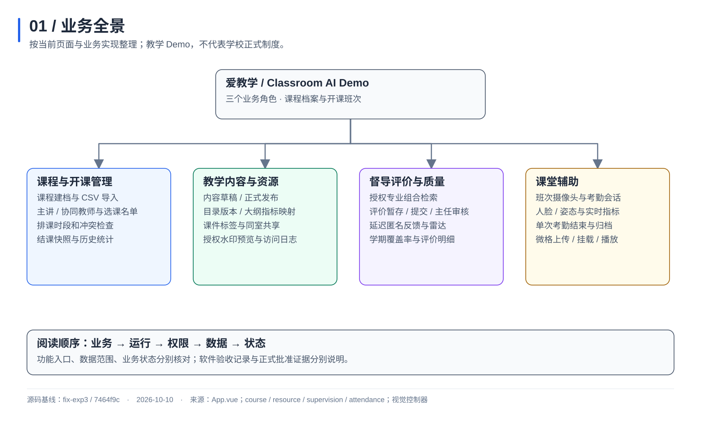
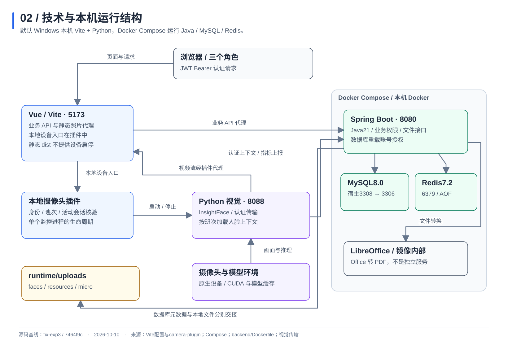
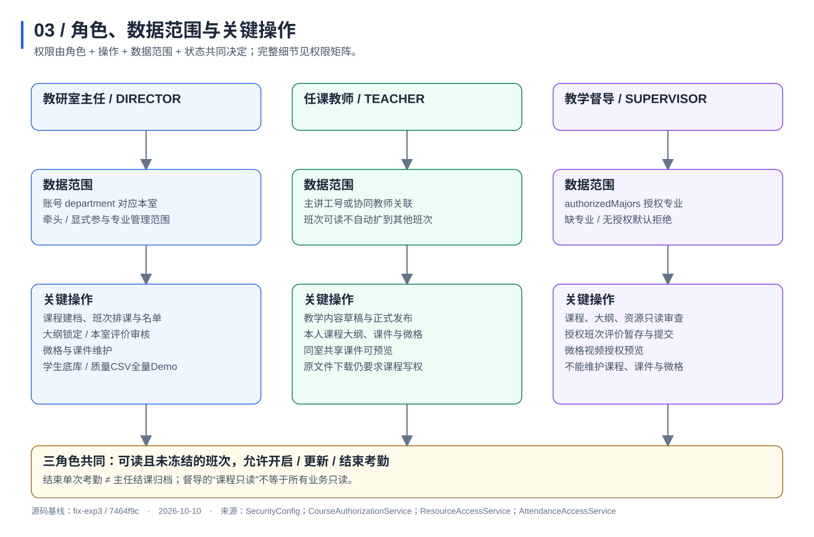
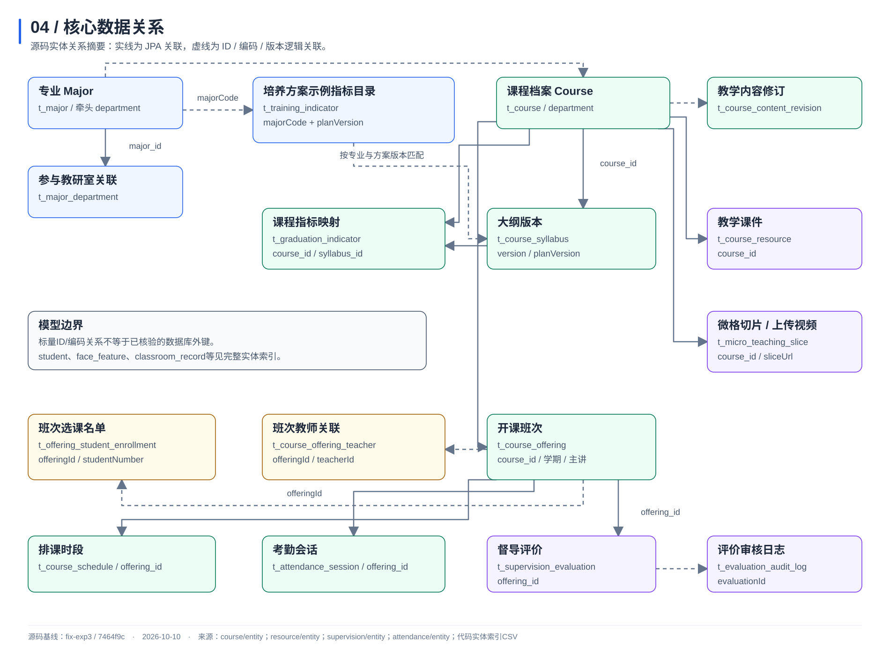
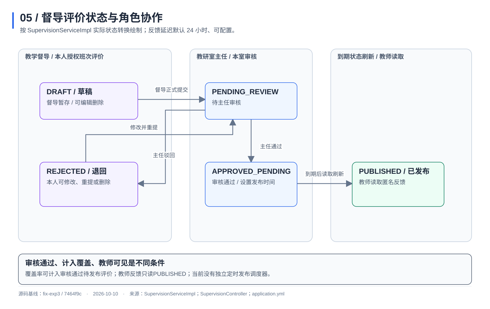

# 爱教学｜开发维护交接材料

2026-10-10 · 当前源码基线 fix-exp3 / 7464f9c · v1

## 01 项目定位与交接基线

“爱教学（Classroom AI Demo）”是面向教研室主任、任课教师和教学督导的教学管理与课堂辅助演示系统。项目围绕课程档案和学期内的开课班次，提供课程导入、排课和历史归档，教学内容草稿与发布，大纲指标映射，课件标签、共享和水印预览，督导评价审核、延迟匿名反馈与学期覆盖率统计，以及摄像头考勤和微格视频。前端采用 Vue 3 / TypeScript / Vite，后端采用 Java 21 / Spring Boot 3.3.4，Python 处理视觉和原生设备，MySQL、Redis 与本地文件承担不同的数据存储职责。[S43]、[S42]、[S32]、[S35]、[S34]

- 材料对象：接手开发与维护的人。范围：本轮当前本地工作区实现，非学校正式制度说明。
- 版本：`fix-exp3`，`7464f9cf5875ec3e416d313e11c9838f5a2bec15`；核对日期 2026-10-10，Asia/Shanghai。
- 既有推送记录记载该提交当时已同步远端，本轮未重新联网核验远端。[S49]
- 工作区存在既有过程文档修改与本地未跟踪材料；不能把 HEAD 当作全部本地资料的打包清单。本次建立源码指纹并在交付前比对。
- 本轮重新核对源码、配置、实体和既有验收报告；未重跑业务测试、未操作摄像头、未重启日常服务，未验证当前运行 JAR/镜像与 HEAD 一致。
- 当前为教学 Demo。已确认没有真实培养方案；合成指标只能作为示例，不作为正式认证或真实培养方案材料。负责人、交接验收日期、目标机器配置：资料未提供。

本包包括说明、五张可阅读图示及其源文件、关键操作权限矩阵、接口/实体索引和源码依据索引；不包含应用源码副本、数据库、人脸向量、真人摄像头截图、模型或运行环境安装包。

## 02 业务全景与现有页面



当前顶层导航有六类入口：主任工作台、教师工作台、督导工作台、微格教学视频、课堂智能考勤大屏、学生人脸档案库。三角色各显示自己的工作台；微格和考勤共享入口；学生档案仅主任。前端以 `activeTab` 切换组件，不应描述为已经采用 Vue Router 的多路由应用。[S32]

| 页面入口 | 主要实现文件 | 业务职责 |
| --- | --- | --- |
| 主任工作台 | `frontend/src/views/DirectorDeskView.vue` | 课程建档/导入、班次/排课/名单、专业授权、大纲审查和评价审核 |
| 教师工作台 | `frontend/src/views/TeacherDeskView.vue` | 本人课程内容发布、课件管理、大纲映射、历史和反馈 |
| 督导工作台 | `frontend/src/views/SupervisorDeskView.vue` | 授权课程检索、资源审查、评价和统计 |
| 考勤大屏 | `frontend/src/views/AttendanceDashboardView.vue` | 班次/会话选择、模拟或真实摄像头、实时状态和会话归档 |
| 微格视频 | `frontend/src/views/MicroTeachingView.vue` | 环节筛选、外部地址挂载、平台视频上传和授权播放 |
| 学生人脸档案 | `frontend/src/views/StudentManageView.vue` | 主任维护学生、照片与人脸特征 |

页面入口与后端授权分别维护；能看到入口不等于能够操作任意数据。业务故事编号和软件验收范围见既有本日报告，不根据页面数量推算已完成故事数。[S47]

## 03 技术结构与本机部署



默认启动方式为 Windows 本机 Vite + Python 原生进程，以及 Docker Compose 中的后端、MySQL、Redis。LibreOffice 在后端镜像内，承担 Office 转 PDF，不是独立服务或微服务。[S33]、[S34]、[S35]、[S44]

| 组件 | 默认位置/端口 | 说明与来源 |
| --- | --- | --- |
| Vue/Vite | `127.0.0.1:5173` | 端口严格占用检查；业务代理默认8080 [S33] |
| Java业务后端 | Docker发布 `8080` | Java21、Spring Boot3.3.4 [S35]、[S42] |
| Python摄像头进程 | 本机 `8088` | 插件按需启动；`CLASSROOM_MONITOR_PORT`可覆盖 [S34] |
| MySQL | 宿主默认 `3308` → 容器 `3306` | `MYSQL_PORT`可覆盖；卷 `classroom_mysql_data` [S35] |
| Redis | 宿主/容器 `6379` | Redis7.2-alpine、AOF；卷 `classroom_redis_data` [S35] |
| LibreOffice | 后端容器内部 | DOC/DOCX/PPT/PPTX转换；直接运行Windows JAR需另装或配置 [S44]、[S13] |

认证主链路为 JWT Bearer：前端请求附加令牌；过滤器每次从账号库加载最新角色和专业授权，再填充 `SecurityContext` / `AuthContext`。项目仍保留旧会话拦截器代码，但没有理由把当前主链路表述为会话登录。[S31]、[S01]

Vite 本地插件提供摄像头启动、停止、状态、视频流和人脸登记/验证入口。它先向后端核验身份；摄像头启动还核验班次与活动考勤会话。静态 `dist` 不提供这组本地进程管理接口。插件管理一个监控进程，会核对使用者；这不是已实现的多教室并发调度服务。[S34]、[S26]

运行中视频流由浏览器经 Vite 插件代理读取；视觉指标则由 Python 经认证传输上报 Java。摄像头上下文只读取所选班次已选学生的有效512维特征，不需要教师/督导调用主任全量底库接口。通用 `/api/visual/report/stream` 的 `attendanceSessionId` 当前仍为可选字段，不能将本地摄像头启动约束写成该接口所有调用都强制要求会话。[S26]、[S27]

视觉依赖按 `vision/requirements.txt` 安装：NumPy1.x、OpenCV、InsightFace0.7.3、ONNX Runtime GPU1.21.1、Pillow。监控使用 `buffalo_l` 并配置CUDA/CPU provider；独立 `face_recognition.py` 对CUDA有严格检查。两种入口的回退行为不同，不宣称所有入口均可无GPU运行。模型缓存与 `vision/models/` 的实际位置需要在新机器按入口核对。[S38]、[S39]、[S40]

## 04 角色权限与接口依据



权限要同时看角色、操作、数据范围和状态。主任管理本教研室课程；教师按班次主讲/协同关系获得访问范围；督导按授权专业访问。课程范围与班次范围分别校验，课程可读不等于可读该课程所有班次。[S02]、[S03]

主任的专业管理范围来自牵头或显式参与关联；课程管理仍限本室。公共培养方案目录写入仅牵头主任，参与主任不因此获得跨室课程写权限。账号授权变更保留其他主任授予的专业。[S54]、[S10]、[S28]

下表逐项列出关键操作。对应CSV还包含实际HTTP方法、路径、执行层和完整源码行号。表中“拒绝”是当前实现规则，不是建议政策。

| 编号 / 操作 | 主任 | 教师 | 督导 | 状态与边界 | 依据 |
| --- | --- | --- | --- | --- | --- |
| P01 课程列表、详情与课程CSV导出 | 本室 | 本人关联课程 | 授权专业 | 课程CSV按课程可读范围过滤；不同于全量质量报告CSV | [S02]、[S01] |
| P02 课程建档、编辑和删除 | 本室 | 拒绝 | 拒绝 | 编辑仍使用POST；编码不可原地改；已有教学关联不能原地换专业 | [S01]、[S05] |
| P03 课程CSV模板、预检和确认导入 | 本室及关联专业 | 拒绝 | 拒绝 | 主任身份与专业/教研室业务校验共同生效 | [S01]、[S56]、[S05] |
| P04 开课查询、详情与历史 | 本室 | 本人主讲/协同班次 | 授权专业 | 在读人数按名单；冻结班次按快照；班次专业缺失时可回退课程专业 | [S02]、[S03]、[S53] |
| P05 创建、编辑、删除班次 | 本室 | 拒绝 | 拒绝 | 冻结拒绝编辑；变更教师/学期须检查排课冲突 | [S01]、[S06] |
| P06 结课归档 | 本室 | 拒绝 | 拒绝 | 冻结名单、人数及历史快照；不等于结束单次考勤 | [S01]、[S07] |
| P07 读取班次选课名单 | 本室 | 本人关联班次 | 授权专业班次 | enrolled按班次；available仅未冻结本室主任返回未选学生，其他角色为空 | [S02]、[S57]、[S01] |
| P08 增删选课名单 | 本室 | 拒绝 | 拒绝 | 冻结班次拒绝写入 | [S01]、[S07] |
| P09 读取排课 | 本室 | 本人关联班次 | 授权专业班次 | 按关联班次权限过滤 | [S02]、[S08] |
| P10 排课创建、删除与冲突检查 | 本室 | 拒绝 | 拒绝 | 冻结限制、教师/教室时段冲突与学期锁 | [S01]、[S08] |
| P11 读取、保存教学内容草稿 | 拒绝 | 本人关联课程 | 拒绝 | 草稿GET也是教师专属；校验草稿ID、锁版本、发布基线版本 | [S01]、[S04]、[S03] |
| P12 发布与读取正式教学内容 | 只读本室正式版 | 本人关联课程发布/读取 | 只读授权正式版 | 简介、考核、目标必填；POST仅教师；读者看正式发布版 | [S01]、[S04]、[S02] |
| P13 大纲和指标映射读取 | 本室 | 本人关联课程 | 授权专业 | 最新大纲与对应映射；历史版本保留 | [S09]、[S02] |
| P14 大纲保存与从目录创建 | 本室 | 本人关联课程 | 拒绝 | 创建绑定方案版本；新建为DRAFT；保存仅DRAFT/SUBMITTED；LOCKED创建新版本 | [S09]、[S11] |
| P15 新增、编辑、删除指标映射 | 本室 | 本人关联课程 | 拒绝 | 仅最新未锁大纲；编号类别一致；支撑权重H/M/L | [S09]、[S11] |
| P16 审查锁定大纲 | 本室 | 拒绝 | 拒绝 | 独立主任接口；锁定记录操作者；不要求绘制未实现的APPROVED审批流程 | [S01]、[S09]、[S11] |
| P17 培养方案目录和版本读取 | 牵头/参与专业 | 本室关联专业或本人授课专业 | 授权专业 | 与GET /majors的教师空列表不同；推荐模板与导入目录分开 | [S10]、[S03]、[S54] |
| P18 公共培养方案目录导入 | 仅牵头专业 | 拒绝 | 拒绝 | 被大纲引用的版本不可变更内容；相同内容幂等 | [S10]、[S09] |
| P19 专业选项列表 | 牵头/参与专业 | 返回空列表 | 授权专业 | 教师不能按目录读取权限推断此接口会返回专业选项 | [S29]、[S54] |
| P20 教师字典列表 | 登录可读全量 | 登录可读全量 | 登录可读全量 | 当前控制器findAll；不扩大课程、班次写权限 | [S30]、[S01] |
| P21 督导账号列表、创建和专业授权 | 主任专属 | 拒绝 | 拒绝 | 列表为督导全量；只授权自身牵头/参与专业；保留其他主任授予的专业 | [S28]、[S54]、[S01] |
| P22 课件列表、详情及授权预览 | 本室 | 本人课程或同室共享资源 | 授权专业 | 登录、申请人绑定、5分钟默认有效期、访问时重新校验范围 | [S12]、[S13]、[S41] |
| P23 课件上传、元数据编辑与删除 | 本室 | 本人关联课程 | 拒绝 | 元数据POST须已有ID；不可更换课程/文件；上传类型和大小可配置 | [S15]、[S12]、[S01] |
| P24 课件原文件下载 | 本室可写课程 | 本人关联可写课程 | 拒绝 | 校验课程写权限；共享预览不授予原文件下载权 | [S14]、[S12] |
| P25 微格按课程、环节检索与平台视频播放 | 本室 | 本人关联课程 | 授权专业 | 环节检索过滤可读课程；平台视频读取校验实际课程；外部URL另走播放器 | [S16]、[S17]、[S02] |
| P26 微格挂载、上传与删除 | 本室 | 本人关联课程 | 拒绝 | 上传MP4/WebM、100MB固定上限；元数据不可重挂平台受控路径；删除不回收磁盘视频 | [S16]、[S17] |
| P27 评价列表与详情 | 本室各状态 | 本人班次PUBLISHED且脱敏 | 授权范围内本人各状态及已发布评价 | 读取前刷新到期状态；教师隐藏督导身份及审核备注 | [S19]、[S18] |
| P28 评价暂存、提交、修改与删除 | 拒绝 | 拒绝 | 本人授权班次评价 | 已有记录仅本人DRAFT/REJECTED可修改删除；正式提交校验评分和必填 | [S01]、[S18]、[S19] |
| P29 评价审核与审计日志 | 本室 | 拒绝 | 拒绝 | 审核仅PENDING_REVIEW；通过进入APPROVED_PENDING，默认24小时后可发布 | [S20]、[S41]、[S01] |
| P30 质量看板、覆盖明细和预警 | 本室有效班次 | 拒绝 | 授权专业有效班次 | 覆盖按学期课程去重；审核通过待发布评价也可计入覆盖 | [S21]、[S22] |
| P31 教学质量雷达 | 本室有效班次评价 | 本人姓名且工号匹配班次主讲 | 授权专业有效班次评价 | 雷达按主讲工号，非一般协同班次规则；PUBLISHED或审核通过且到期的评价 | [S21]、[S55] |
| P32 年度质量报告CSV | 全量Demo | 拒绝 | 拒绝 | 用户已确认的演示范围；不同于课程CSV按范围过滤 | [S21]、[S23]、[S51] |
| P33 学生与人脸底库管理 | 全量Demo | 拒绝 | 拒绝 | 主任角色专属；具体97项后端接口见接口清单 | [S01]、[S51] |
| P34 考勤当前会话与历史读取 | 可读班次 | 可读班次 | 可读班次 | 未指定班次时只找最新可见活动会话；冻结班次无活动会话 | [S24]、[S25] |
| P35 开启、实时更新与结束单次考勤 | 可读未冻结班次 | 可读未冻结班次 | 可读未冻结班次 | 三角色都可写；结束的是考勤会话，不冻结开课班次 | [S24]、[S25] |
| P36 摄像头班次上下文与视觉指标 | 可读班次 | 可读班次 | 可读班次 | monitor-context要求活动会话；写入拒绝冻结；本地摄像头上报绑定会话，通用stream DTO会话字段仍可选 | [S26]、[S27]、[S01] |
| P37 本地摄像头启停、状态与视频流 | 允许 | 允许 | 允许 | Vite插件身份核验；启动须合法班次与活动会话；单进程占用与视频授权 | [S34]、[S26] |
| P38 本地人脸登记与验证入口 | 允许 | 拒绝 | 拒绝 | 由Vite插件先核验主任身份再启动本地Python | [S34]、[S01] |


需要保留的接口差异：

- 教学内容草稿的GET和PUT均仅教师；主任只能通过正式版读取入口查阅，不能代教师发布。[S01]、[S04]
- 共享资源可允许同室其他教师预览，原文件下载却要求课程写权限；督导不能下载原文件。[S12]、[S14]
- 督导可提交评价、操作可读未冻结班次的考勤，但不能维护课程、课件或微格。[S24]、[S18]、[S16]
- 教师 `GET /api/v1/majors` 返回空列表；培养方案目录接口另允许本室关联专业或本人授课专业。教师字典列表当前则是登录后的全量 `findAll()`。[S29]、[S10]、[S30]
- 主任质量报告CSV和学生底库全量访问是已确认Demo规则；课程CSV导出仍按课程范围过滤。[S51]、[S23]、[S02]
- `/uploads/resources/**` 与 `/uploads/micro/**` 被直接路径拒绝；`/uploads/faces/**` 在当前SecurityConfig公开放行，Vite也有照片静态读取。不能把所有上传文件都描述成统一鉴权。[S01]、[S34]

课程/班次/资源等业务接口须登录；登录、csrf、OPTIONS和配置中列出的静态/API文档入口有公开规则，不能笼统说所有URL均需认证。[S01]

## 05 核心数据关系与统计口径



图中实线为源码中的JPA实体关联，虚线为ID、编码或版本的逻辑关联。本轮读取实体，没有查询目标运行数据库的实际外键DDL。完整实体索引包含24个 `@Entity`，只表示当前源码实体数量，不等于运行数据库表数量。

| 核心对象 | 实体对应表 | 维护时必须知道 |
| --- | --- | --- |
| 课程 | `t_course` | 课程档案；专业用majorId/majorCode标识，教研室用department |
| 开课班次 | `t_course_offering` | 课程+学期+教学班+主讲；归档快照独立保存 |
| 班次教师关联 | `t_course_offering_teacher` | 标量offeringId/teacherId；PRIMARY/ASSISTANT；访问按工号关联 |
| 班次选课名单 | `t_offering_student_enrollment` | offeringId+studentNumber；studentId允许空；行政班级只是属性 |
| 排课 | `t_course_schedule` | JPA关联班次；周次、星期、节次、教室和冲突校验 |
| 大纲 | `t_course_syllabus` | syllabus.version和planVersion分别记录；不是内容发布号 |
| 映射 | `t_graduation_indicator` | 关联课程和大纲；历史无大纲记录另作兼容 |
| 专业目录 | `t_training_indicator` | majorCode+planVersion+indicatorCode唯一；不是课程映射表 |
| 内容修订 | `t_course_content_revision` | courseId、draftId、lockVersion、publishVersion共同作用 |
| 课件/微格 | `t_course_resource` / `t_micro_teaching_slice` | 数据库存元数据；实际文件另在上传目录 |
| 评价/考勤 | `t_supervision_evaluation` / `t_attendance_session` | 通过JPA关联班次；两种状态机分别管理 |

统计和历史口径：

- 开课列表/历史的在读人数来自选课名单，冻结人数取快照；累计人次按班次累加，同班次多教师不重复。[S53]
- 考勤服务应到人数优先名单，名单计数为0时仍兼容回退班次 `studentCount`；视觉上报按实际名单判断本班出勤，未匹配者不计入本班出勤。两段代码口径要分别维护。[S25]、[S27]
- 结束考勤把会话设为FINISHED；主任结课归档把班次设为FINISHED并冻结快照。两者不是同一个操作。[S25]、[S07]
- 覆盖率分母为选定学期、可见范围内IN_PROGRESS/FINISHED班次对应的去重课程；分子为存在符合审核状态评价的课程。APPROVED_PENDING也可计入覆盖，教师反馈仍须PUBLISHED。[S22]、[S19]
- `classroom_record` 存视觉指标、字符串sessionId等，没有本轮图示中可宣称的offering_id/attendance_session_id实体外键；视觉服务更新考勤会话和该记录是业务链路关联，不能伪造数据库关系。[S27]

完整表名、字段与JPA关联见实体索引CSV；这是一份源码模型索引，不含业务数据。

## 06 评价流程与版本状态



督导可暂存DRAFT，正式提交进入PENDING_REVIEW；主任只审核待审记录，通过后进入APPROVED_PENDING并设置发布时间，驳回为REJECTED。督导只能修改或删除本人DRAFT/REJECTED。[S18]、[S20]

默认延迟24小时，可配置。到期状态刷新由评价读取方法调用 `refreshDesensitizeStatus()`，当前未发现独立定时发布调度器；图示写“到期后读取刷新”，不能写成精确定时自动推送。教师看到PUBLISHED且脱敏后的班次评价。[S19]、[S20]、[S41]

版本约束另行区分：

- 内容草稿/正式发布：草稿读取可创建新草稿；保存与发布核验草稿ID、锁版本和基线发布号；发布生成正式版本，旧草稿退休。[S04]
- 大纲保存：服务只接受DRAFT或SUBMITTED；LOCKED由独立主任锁定接口产生，锁定/历史大纲不可原地编辑。实体遗留APPROVED默认值不能据此画出未实现的完整审批链。[S09]、[S11]
- 专业目录：被课程大纲引用后不可覆盖为不同内容，要用新目录版本；目录版本、大纲版本和教学内容发布号不是同一个字段。[S10]、[S09]

## 07 目录与维护入口

| 目录/文件 | 当前职责 | 接手先看 |
| --- | --- | --- |
| `frontend/` | Vue页面、组件、API、测试、Vite本地插件 | `src/App.vue`、`src/api/index.ts`、`dev/camera-plugin.mjs` |
| `backend/` | Java配置、实体、业务接口和测试 | `src/main/java/com/classroom/ai/modules/` |
| `vision/` | Python监控、人脸登记/验证、传输、诊断和依赖 | `classroom_monitor.py`、`monitor_transport.py`、`backend_auth.py` |
| `scripts/` | 实际启动、Compose封装、验证与部署 | `start_project.ps1`、`compose.ps1`、`deploy/`、`tests/` |
| `runtime/` | 上传文件、日志、PID、本地运行材料 | `uploads/`、`logs/`；Git忽略，不随clone恢复 |
| `raw/` | 原始资料 | 当前只有README目录说明；保持原样 |
| `docs/` | 分析、方案、取证与历史 | 本轮源码对齐与材料验证记录 |
| `memory-bank/` | 已确认的长期口径 | `project-context.md`；读最新更正，区分历史状态 |
| `assets/` | 复用素材 | 按实际使用检查 |
| `output/` | 最终交付 | 本交接材料与既有验收报告 |
| 根目录启动/停止脚本 | 用户入口 | 启动ps1转调scripts实现；停止ps1保留根目录实现 |

传统视觉/学生接口仍在 `backend/src/main/java/com/classroom/ai/controller/`、`service/impl/`、`entity/`、`repository/`，不能只搜索modules。权限重点是SecurityConfig、JwtAuthenticationFilter、CourseAuthorizationService、ResourceAccessService、AttendanceAccessService。

根目录现有 `docker/`、`initialize.sql`、`design-system/` 与历史资料保持原位。当前Compose实际入口是 `scripts/deploy/docker-compose.yml`，MySQL基线来自该目录下 `mysql/init/initialize.sql`，不是把根目录SQL当默认初始化入口。未替这些目录编造“可删除”结论。

维护角色建议分别覆盖前端交互、Java业务与权限、Python视觉与设备、部署/数据恢复、验收与资料。这是交接职责建议；具体负责人姓名与职责分配资料未提供。

## 08 启动、数据恢复与接手验证

接手机器先具备 Node/npm、Java21、Maven、Docker，以及单独配置的Python环境和视觉依赖。锁定前端依赖优先使用项目锁文件；已有 `.venv1` 是本机环境，不能视为跨机器安装包。摄像头与GPU条件要按使用入口检查。

从项目根目录运行：

```powershell
.\start_project.ps1 -Rebuild
.\scripts\compose.ps1 ps
```

启动实现先启动MySQL/Redis，检查已有库，再运行可重复的Sprint2迁移，构建后端JAR/镜像并启动后端、Vite。新数据卷按Compose基线初始化；已有库不重导基线。`-SkipBuild`只复用已有产物，不证明已运行最新源码。根启动入口实际调用 `scripts/start_project.ps1`。[S36]、[S35]

停止：

```powershell
.\stop_project.ps1
# 需要一起停止数据库服务时使用既有参数
.\stop_project.ps1 -StopDocker
```

停止脚本停止前端/后端进程及后端容器，`-StopDocker`另外停止MySQL/Redis；脚本不删除数据卷。摄像头正常从页面停止，Vite服务关闭时插件也有进程释放钩子。[S37]、[S34]

数据交接与恢复需要分开做：

| 对象 | 现有存放位置 | 恢复要求 |
| --- | --- | --- |
| MySQL业务数据 | 卷 `classroom_mysql_data` | 按实际数据库配置导出/恢复；带上课程、账号、班次、名单、版本和评价等关联数据 |
| Redis | 卷 `classroom_redis_data` | 保存运行状态；实时指标有TTL，重启恢复不能当作正在上课 |
| 照片/课件/视频 | `runtime/uploads/faces`、`resources`、`micro` | 与数据库元数据保持一致；课件资源路径与人脸路径有不同解析逻辑 |
| 视觉模型与环境 | `vision/models/`及InsightFace当前环境缓存 | 按入口和机器核对，不随Git恢复 |
| 配置 | Compose、application.yml、环境变量、可选本地env | 单独配置连接和凭据；交接材料不保存凭据 |

本包提供恢复对象和步骤说明，未执行备份或恢复，也没有数据库备份文件。恢复建议在隔离环境完成：固定版本 → 恢复数据库与对应上传文件 → 配置依赖/模型 → 核对账号范围与数据一致性 → 运行核心流程。不能用“clone成功”代替数据恢复验收。[S35]、[S45]

既有验证入口：

```powershell
# 常规后端、前端测试/构建与Python测试；Offline要求Maven依赖已缓存
.\scripts\run-tests.ps1 -Offline
# 真MySQL与真实浏览器的专项，按runner要求准备Docker/Chrome/Playwright
.\scripts\run-exp3-mysql-tests.ps1
.\scripts\run-exp3-browser-tests.ps1
```

应检查Python测试实际使用的解释器。浏览器runner可用 `PLAYWRIGHT_MODULE` 和 `EXP3_CHROMIUM_PATH` 指定已有安装；测试脚本和过程记录是可复现入口，不把条件跳过记成通过。[S52]、[S46]、[S48]

建议接手验收：三个角色分别登录 → 主任建档/排课/名单 → 教师发布/课件 → 督导检索/评价 → 主任审核 → 教师发布后反馈；再检查越权、过期票据、共享撤销、锁定大纲、冻结班次和摄像头/微格。仅在隔离测试库进行写入验收，按runner实际清理要求操作。该验收是接手执行清单，不宣称本轮已重新执行。

## 09 已有验证、限制与复核事项

| 事项 | 当前依据 | 交接表述 |
| --- | --- | --- |
| Sprint2八故事软件功能 | 本日既有复核报告 [S47] | 报告记录满足验收标准；本轮引用，不重复宣称实跑 |
| 正式Sprint2收尾 | 同报告 | 评审/回顾及自然人交付批准证据仍缺；不以功能通过推断正式批准 |
| 摄像头链路 | 本日已有单人现场报告 [S46] | 已有单人现场与连续上报证据；不等于多人/光照总体准确率评估 |
| 微格播放 | 同报告 | 平台合成视频已验证解码；旧外部视频地址有效性另需复核 |
| 测试导入修复 | 本日测试修复报告 [S48] | 真实MySQL专项7/7通过；常规回归存在条件跳过；以各自报告为准 |
| 平台视频删除 | 当前MicroTeachingServiceImpl [S16] | 删除数据库切片记录；磁盘视频回收尚未实现 |
| 预览票据 | 当前ResourceFileService [S13] | 进程内Map，默认5分钟；后端重启票据失效；未实现跨实例共享票据 |
| 运行实例版本 | 本轮未查询服务 | 待确认：实际部署JAR/镜像是否与本文源码基线一致 |
| 接手责任与环境 | 资料未提供 | 待确认：负责人、验收日期、新机器摄像头/GPU和模型配置 |

本轮交付完成的是与当前源码对齐的材料制作，不是一次新增部署或全量业务验收。未修改业务源码、raw原件、数据卷、上传文件或长期背景；未读取/复制凭据、人脸向量和真人截图。

README存在早于后续修复的目录数量和历史待办描述，本材料以当前源码、最新明确口径和有日期的验收报告分别说明；历史报告中的“未提交”状态不覆盖当前本地Git与已有推送证据。

## 10 来源与可编辑附件

当前项目 `raw/` 只有目录说明，业务原始资料未提供。[S50] 本轮只使用本地源码、配置、现有文档和用户已确认背景；未联网查外部资料，也未重新读取项目外原始DOCX。Sprint原始要求仅通过既有复核报告转引，不能说本轮重新验过原件。[S47]、[S51]

交接页所有 `[Sxx]` 对应下面的真实文件与本轮核对行号。源码索引只保存路径、行号和SHA256，不保存文件中的凭据或业务个人数据。文件路径相对于项目根目录；迁移项目目录后仍可定位。

| 来源编号 | 文件路径与行号 |
| --- | --- |
| S01 | `backend/src/main/java/com/classroom/ai/modules/auth/security/SecurityConfig.java:59` |
| S02 | `backend/src/main/java/com/classroom/ai/modules/course/service/CourseAuthorizationService.java:45` |
| S03 | `backend/src/main/java/com/classroom/ai/modules/course/service/CourseAuthorizationService.java:268` |
| S04 | `backend/src/main/java/com/classroom/ai/modules/course/controller/CourseContentController.java:27` |
| S05 | `backend/src/main/java/com/classroom/ai/modules/course/service/impl/CourseServiceImpl.java:46` |
| S06 | `backend/src/main/java/com/classroom/ai/modules/course/service/CourseOfferingManagementService.java:41` |
| S07 | `backend/src/main/java/com/classroom/ai/modules/course/service/CourseOfferingManagementService.java:106` |
| S08 | `backend/src/main/java/com/classroom/ai/modules/course/service/impl/CourseScheduleServiceImpl.java:58` |
| S09 | `backend/src/main/java/com/classroom/ai/modules/course/controller/SyllabusController.java:49` |
| S10 | `backend/src/main/java/com/classroom/ai/modules/course/controller/SyllabusController.java:173` |
| S11 | `backend/src/main/java/com/classroom/ai/modules/course/service/impl/SyllabusServiceImpl.java:230` |
| S12 | `backend/src/main/java/com/classroom/ai/modules/resource/service/ResourceAccessService.java:17` |
| S13 | `backend/src/main/java/com/classroom/ai/modules/resource/service/ResourceFileService.java:56` |
| S14 | `backend/src/main/java/com/classroom/ai/modules/resource/service/ResourceFileService.java:177` |
| S15 | `backend/src/main/java/com/classroom/ai/modules/resource/controller/CourseResourceController.java:46` |
| S16 | `backend/src/main/java/com/classroom/ai/modules/resource/service/impl/MicroTeachingServiceImpl.java:43` |
| S17 | `backend/src/main/java/com/classroom/ai/modules/resource/service/MicroTeachingVideoService.java:30` |
| S18 | `backend/src/main/java/com/classroom/ai/modules/supervision/service/impl/SupervisionServiceImpl.java:87` |
| S19 | `backend/src/main/java/com/classroom/ai/modules/supervision/service/impl/SupervisionServiceImpl.java:213` |
| S20 | `backend/src/main/java/com/classroom/ai/modules/supervision/service/impl/SupervisionServiceImpl.java:183` |
| S21 | `backend/src/main/java/com/classroom/ai/modules/supervision/controller/SupervisionAnalyticsController.java:27` |
| S22 | `backend/src/main/java/com/classroom/ai/modules/supervision/service/impl/SupervisionAnalyticsServiceImpl.java:55` |
| S23 | `backend/src/main/java/com/classroom/ai/modules/supervision/service/impl/SupervisionAnalyticsServiceImpl.java:223` |
| S24 | `backend/src/main/java/com/classroom/ai/modules/attendance/service/AttendanceAccessService.java:31` |
| S25 | `backend/src/main/java/com/classroom/ai/modules/attendance/service/impl/AttendanceServiceImpl.java:97` |
| S26 | `backend/src/main/java/com/classroom/ai/controller/CameraMonitorController.java:27` |
| S27 | `backend/src/main/java/com/classroom/ai/service/impl/VisualDashboardServiceImpl.java:115` |
| S28 | `backend/src/main/java/com/classroom/ai/modules/auth/controller/DirectorController.java:120` |
| S29 | `backend/src/main/java/com/classroom/ai/modules/course/controller/MajorController.java:20` |
| S30 | `backend/src/main/java/com/classroom/ai/modules/course/controller/TeacherController.java:20` |
| S31 | `backend/src/main/java/com/classroom/ai/modules/auth/security/JwtAuthenticationFilter.java:38` |
| S32 | `frontend/src/App.vue:168` |
| S33 | `frontend/vite.config.ts:10` |
| S34 | `frontend/dev/camera-plugin.mjs:124` |
| S35 | `scripts/deploy/docker-compose.yml:2` |
| S36 | `scripts/start_project.ps1:1` |
| S37 | `stop_project.ps1:1` |
| S38 | `vision/requirements.txt:1` |
| S39 | `vision/classroom_monitor.py:197` |
| S40 | `vision/face_recognition.py:36` |
| S41 | `backend/src/main/resources/application.yml:54` |
| S42 | `backend/pom.xml:21` |
| S43 | `frontend/package.json:12` |
| S44 | `backend/Dockerfile:2` |
| S45 | `.gitignore:22` |
| S46 | `output/20261010-camera-integration-fix-v1.md:25` |
| S47 | `output/20261010-sprint2-readiness-check-v1.md:5` |
| S48 | `output/20261010-attendance-test-import-fix-v1.md:1` |
| S49 | `docs/20261010-attendance-test-import-fix-v1/push-result.json:4` |
| S50 | `raw/README.md:1` |
| S51 | `memory-bank/project-context.md:145` |
| S52 | `scripts/run-tests.ps1:1` |
| S53 | `backend/src/main/java/com/classroom/ai/modules/course/controller/CourseOfferingHistoryController.java:44` |
| S54 | `backend/src/main/java/com/classroom/ai/modules/course/repository/MajorRepository.java:17` |
| S55 | `backend/src/main/java/com/classroom/ai/modules/supervision/service/impl/SupervisionAnalyticsServiceImpl.java:150` |
| S56 | `backend/src/main/java/com/classroom/ai/modules/course/service/impl/CourseImportServiceImpl.java:35` |
| S57 | `backend/src/main/java/com/classroom/ai/modules/course/service/impl/CourseServiceImpl.java:188` |


附件：五张SVG和PNG可直接插入文档；Mermaid源文件可编辑逻辑图；HTML离线可读并内嵌全部SVG；Markdown通过相对路径引用图示；权限CSV含操作/角色/状态/接口/依据；接口CSV区分Java后端与Vite本地入口；实体CSV为源码模型索引；manifest记录制作版本、文件哈希和验证范围。整个材料包不依赖网络字体、CDN或在线Mermaid渲染。

